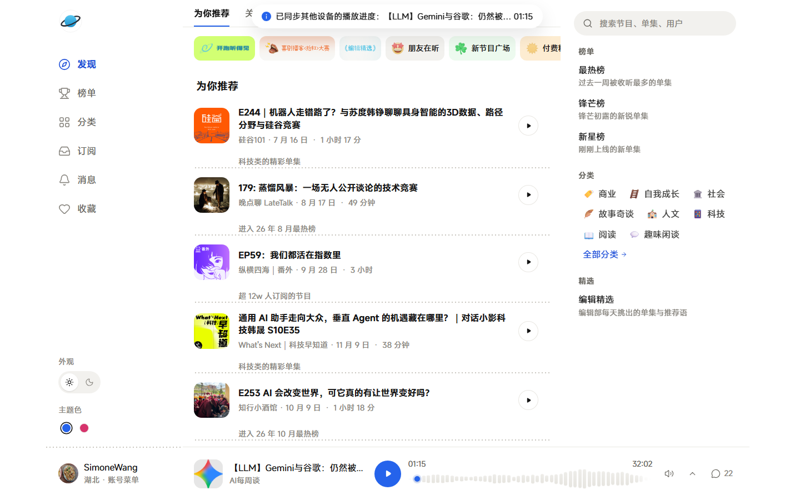
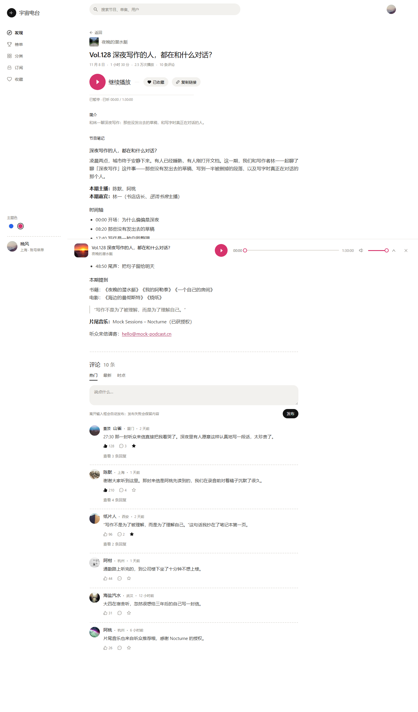

# 宇宙电台 · xyz-web

一个能在浏览器里听**小宇宙播客**的网页客户端：发现好节目、订阅、搜索、看评论、扫码登录、跨设备续听。
界面是「白底墨字」的极简风格，蓝 / 粉两版主题色 + 白天 / 夜间两种外观。

| 发现页 | 单集详情（播放中） |
| --- | --- |
|  |  |

> 它需要一个「后端」帮忙转发小宇宙的接口。**用下面的 Docker 一键部署，前后端会一起自动装好，你不用单独操心后端。**

---

## 一、安装（推荐：Docker 一键部署）

只需要三步：**装 Docker → 下载本项目 → 一条命令启动**。

### 第 1 步：装 Docker

Docker 是一个「把软件连同环境一起打包运行」的工具，本项目用它一键起前端 + 后端。

- **Windows / macOS**：安装 [Docker Desktop](https://www.docker.com/products/docker-desktop/)（官网下载，双击安装）。
  - Windows 需要 **WSL2**（Docker 的运行基础）。安装 Docker Desktop 时按提示启用即可；若提示未开启虚拟化，
    按 [Agent 部署指南 · Windows](docs/AGENT-DEPLOY.md) 的说明开启 WSL2 与 BIOS 虚拟化。
- **Linux**：终端执行 `curl -fsSL https://get.docker.com | sh`。
- **国内网络**：Docker 下载 / 拉镜像可能很慢或失败，请先看 [国内镜像加速](docs/AGENT-DEPLOY.md)（含 WSL2、镜像源配置）。

装好后，终端里能跑通这两条就说明就绪：

```bash
docker --version
docker compose version
```

### 第 2 步：下载本项目

任选一种：

```bash
git clone https://github.com/simiooo/xyzus-web.git
cd xyzus-web
```

或在 GitHub 仓库页面点 **Code → Download ZIP**，解压后进入文件夹（不需要装 git）。

### 第 3 步：启动

```bash
docker compose up -d --build
```

第一次会联网构建几分钟（自动装好前端和补丁后端），耐心等它跑完。完成后：

- **本机访问**：浏览器打开 <http://localhost:8080/>
- **局域网访问**（手机 / 其它电脑）：打开 `http://<主机IP>:8080/`（见下方「配置」）

常用命令：

```bash
docker compose ps               # 看运行状态
docker compose logs -f backend  # 看后端日志（Ctrl+C 退出）
docker compose down             # 停止
docker compose up -d --build    # 更新代码后重新构建
```

> 只想看界面、不想登录 / 装 Docker？开发者可用离线 mock 模式，见 [本地开发](docs/DEVELOPMENT.md)。

---

## 二、配置（可选，默认即可用）

- **换端口**：默认 `8080`。若被占用，改 `docker-compose.yml` 里 `frontend` 的 `ports`（如 `"18080:80"`），再 `docker compose up -d`。
- **局域网访问**：端口已绑 `0.0.0.0`，同一局域网可直接访问。查主机 IP：
  - Windows：`ipconfig`（看 IPv4 地址）
  - macOS：`ipconfig getifaddr en0`
  - Linux：`ip a`
  然后手机 / 其它电脑打开 `http://<主机IP>:8080/`。
- **主题 / 外观**：左栏底部或账号菜单里切换**主题色**（蓝 / 粉）与**外观**（白天 / 夜间）；
  也可用网址直接预览：`http://localhost:8080/?theme=dark&accent=pink`。
- **国内网络加速**：镜像源、WSL2、GitHub 加速等见 [Agent 部署指南](docs/AGENT-DEPLOY.md)（人工也适用）。
- **环境变量 / 直连后端**：一般无需改动；开发者细节见 [本地开发 · 环境变量](docs/DEVELOPMENT.md)。

---

## 三、使用

1. **登录**：打开页面后用**小宇宙 App 扫码登录**（App 里「扫一扫」对准二维码，手机上确认即可）。
   > 旧的短信验证码登录上游已关闭，请用扫码；扫码 / 短信都不行时，登录页底部还有「粘贴 Token」兜底。
2. **逛内容**：
   - **发现**：顶部「为你推荐 / 关注 / 分类 / 精选」四个内容流；
   - **榜单 / 订阅 / 搜索 / 消息 / 我的**：左栏导航（移动端在底部页签）。
3. **播放与续听**：点任意单集即可播放，底部播放条常驻；点播放条展开完整面板（大封面 / ±15 秒 / 倍速）。
   刷新或换设备后会**自动回到上次听的单集与进度**（暂停态，点一下播放即继续）。
4. **看评论 / AI**：单集页有评论（含「时点」评论）、AI 摘要与 AI 文字稿（有则显示，点时间戳可跳播）。
5. **快捷键**：`/` 聚焦搜索、`空格` 播放/暂停、`← →` 前后 15 秒、`M` 静音、`Esc` 收起播放器。

---

## 四、给 Agent / 自动化部署

交给 AI Agent 或脚本在干净机器上部署时，按这份 runbook 走（**先检查再安装、国内 / 国外分支**）：

1. **探测环境**：OS / 架构 + 网络判定国内外（google 不通而 baidu 通 → 国内）。
2. **装依赖**：Git；Docker + Compose v2（Windows 先 WSL2，Linux 用 `get.docker.com`，国内 `--mirror Aliyun`）。
3. **国内配镜像**：registry-mirrors（DaoCloud 等，需实测）；GOPROXY / npm 已内置无需改；GitHub clone 兜底。
4. **克隆 + 启动**：`git clone … && docker compose up -d --build`。
5. **验证**：`docker compose ps` + 本机 `http://localhost:8080/` + 局域网 `http://<主机IP>:8080/` + 扫码登录。

> 完整命令、镜像地址清单、WSL2 / 虚拟化排查、常见坑自查表见 **[docs/AGENT-DEPLOY.md](docs/AGENT-DEPLOY.md)**。

---

## 五、常见问题

| 现象 | 怎么办 |
|---|---|
| 页面打不开 / 「网络异常」 | 后端没起或还在构建：`docker compose ps` 看状态、`docker compose logs backend` 看日志 |
| 国内拉镜像很慢 / 失败 | 配国内镜像加速，见 [Agent 部署指南](docs/AGENT-DEPLOY.md) |
| 登录不了 | 用**扫码登录**（短信通道上游已关闭）；或登录页底部「粘贴 Token」 |
| 某些接口 404 | 后端没打补丁：用本仓库 `docker compose up -d --build` 重新构建 |
| 付费单集没声音 | 需先在小宇宙 App 内购买该单集 |

> 更多排查见 [故障排查](docs/TROUBLESHOOTING.md) 与 [Agent 部署指南 · 常见坑](docs/AGENT-DEPLOY.md)。

---

## 文档索引

**用户 / 部署**
- [Agent 部署指南](docs/AGENT-DEPLOY.md) — 干净机器一键部署 runbook（环境分支 / WSL2 / 国内镜像）
- [故障排查](docs/TROUBLESHOOTING.md) — 接口与运行时问题
- [本地开发](docs/DEVELOPMENT.md) — 真机联调 / 离线 mock / 环境变量 / 截图脚本

**设计 / 实现**
- [设计规范](docs/DESIGN.md) — 视觉与交互的唯一真源
- [架构与部署内部](docs/ARCHITECTURE.md) — 请求链路 / 直连备选 / Docker 内部
- [接口契约](docs/API.md) — 端点总表 / 信封 / 归一化修复
- [功能详解](docs/FEATURES.md) — 登录 / 消息 / 发现 / 评论 / AI / 续听 / 本地缓存 / 增量同步 / 已知限制
- [实测证据](docs/VERIFICATION.md) — curl 清单与构建检查
- [工程约定](AGENTS.md) — 技术栈 / 命令 / 代码规范

**API 调研（历史）**
- [API 清点](docs/API_INVENTORY.md) · [API 缺口](docs/API_GAP.md) · [抓包端点](docs/CAPTURE_ENDPOINTS_2026-11-11.md)
- [需求记录 PRD](PRD.md)（v1.0 历史需求，部分已过期，以以上文档为准）