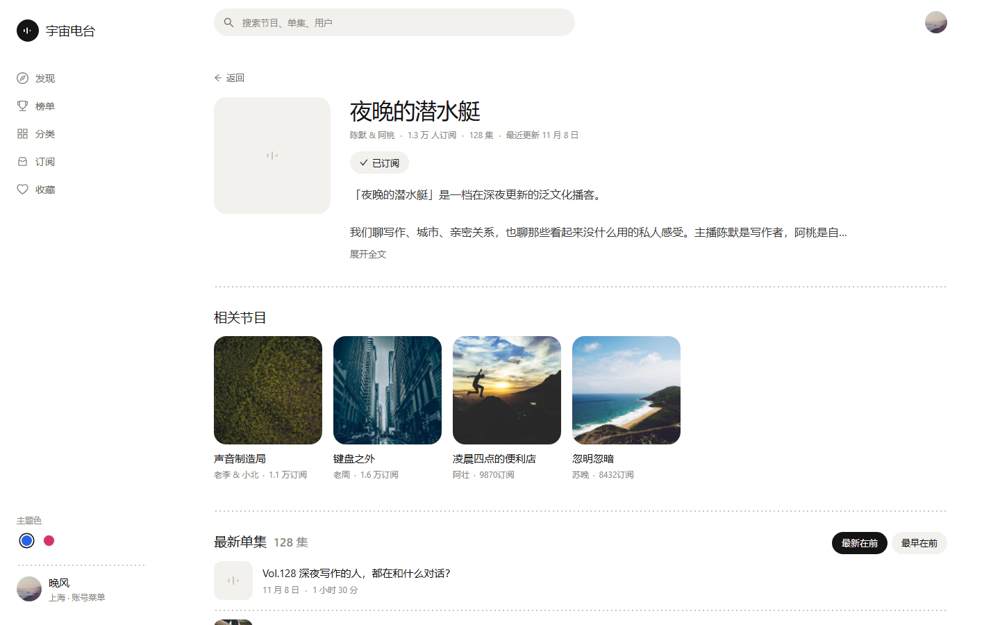
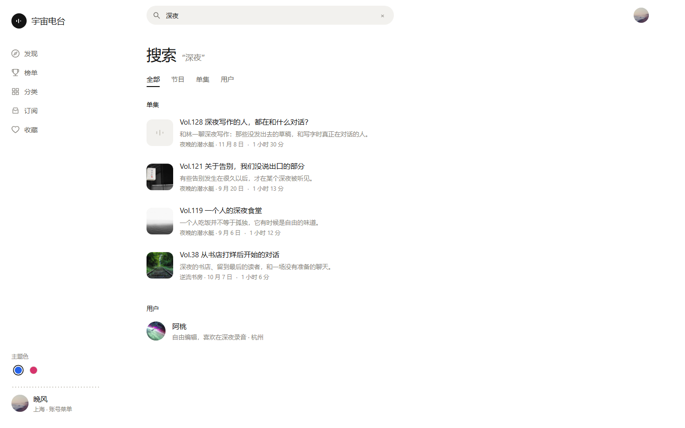

# 宇宙电台 · xyz-web（小宇宙播客 Web 客户端）

基于 **React 19 + TypeScript 6 + Vite 8 + Ant Design 6 + Alova 3 + Zustand 5 + React Router 7 + Tailwind CSS 3** 的播客 Web 客户端，接口对接**自建**的 [ultrazg/xyz](https://github.com/ultrazg/xyz)（Go 单进程，默认端口 `23020`），由它代理小宇宙上游 API。

界面规范见 [`docs/DESIGN.md`](docs/DESIGN.md)｜工程约定见 [`AGENTS.md`](AGENTS.md)。

## 界面（2026-11 维护后的版本）

整站换成「白 & 墨」的极简语言：**白底墨字，几乎不用底色；结构靠点线；一个强调色只留给播放**。

- **两版主题色**：蓝（默认）与粉，左侧栏底部 / 账号菜单里的「主题色」两个色点实时切换，
  选择记在 `localStorage`（`xyz:accent`）。强调色只出现在播放按钮、播放进度条与「正在播放」标记上；
  订阅、收藏、点赞、页签选中一律是墨色。
- **布局**：桌面是「左栏导航 + 顶栏搜索 + 内容区（≤1120）+ 常驻播放条」；移动端换成顶栏 +
  底部四页签 + 悬浮播放条。详情页用 720px 阅读列；浏览页用货架与网格。**不再有第二套右栏播放器**，
  播放条上点击即展开完整播放面板（大封面 / ±15 秒 / 倍速 / 查看单集）。
- **图片渐进加载**：`src/components/ui/SmartImage.tsx` —— 先给一块占位空状态（三根竖线的音频标记），
  缩略图到了先显示（轻微模糊），大图加载完淡入覆盖；任何一档失败都退回上一档，不会出现裂图或永远模糊。
- **发现页（X 式）**：`/` 去掉大标题、副标题和「去榜单」按钮，顶部改成**吸顶的内容流 tab**，
  按使用频率排：**为你推荐（默认）→ 关注 → 分类 → 精选**；榜单属于「有明确目的才去」的工具入口，
  留在左栏主导航，不占发现页 tab。数据：为你推荐 = `/tab_discovery_list`，关注 = `/following_updates_list`
  （复用 FollowingFeed），分类 = `/tab_category_list`，精选 = `/tab_featured_list`；首屏只加载当前 tab，
  切换后保留已加载内容，`?tab=following|category|featured` 可直达（无参数 = 为你推荐）。
- **消息 / 收件箱**：左栏「消息」与移动端顶栏铃铛进入 `/inbox`，页内是「通知 / 收件箱」双 tab：
  通知走 xyz 补丁端点 `/notice_list`（真实抓包已校准：action = `LIKE` / `COMMENT`，触发者在 `source.users[0]` / `source.author`）；
  收件箱走 `/inbox_list_v2`（App 3.4.2 的 v2 接口，`limit:25` + `{pubDate,id}` 游标），可「全部标为已读」调用 `/inbox_remove`；
  未读徽标来自 `/unread_count`（本机已读水位兜底，见 §12）。
- **续听 / 播放现场同步**：播放状态序列化到服务端（`/playback_progress_list|update` + `/episode_played_history_list`），
  刷新 / 重开页面先本地快照恢复（停在原进度、暂停态），再和服务端对账；跨端按 `playedAt` 最后写入优先，
  本端播放中不被远端覆盖，暂停时若远端更新会自动同步进度。详见 §19。
- **相关单集**：单集页在节目笔记之后、评论之前显示「相关单集」（`/related_episode_list`，最多 6 条）。
- **评论增强**：单集页的回复列表走 App 同款 v2（`/comment_list_thread_v2`）；账号菜单新增「我的评论」
  （`/my-comments`，对应 `/comment_list_mine`，最新 / 最热两排序，点一条进所在单集）；评论「时点」tab 可看
  当前播放时间窗附近的时点评论（`/comment_list_timestamp_primary` + `/comment_get`），点时间戳可跳播。
- **AI 摘要 / 文字稿**：单集页增加「AI 摘要」（`/ai_summary_episode_retrieve_brief`，只有上游 ready 时出现，
  限流/无摘要时静默隐藏）和可展开的「AI 文字稿」（`/episode_transcript_get` 取签名地址，正文由
  `/episode_transcript_content` 代理 CDN；按时间点分段，点一行可跳播）。
- **关注动态 / 常听节目**：账号菜单与「我的订阅」页头可进 `/following`（`/following_updates_list`，
  听友推荐的单集 + 推荐语）；「我的订阅」顶部增加「常听节目」横滑货架（`/subscription_often_played`）。
- **星标订阅**：订阅页增加「全部 / 星标」筛选与行尾星标按钮（`/subscription_star`、`/subscription_star_update`，
  xyz 已内置这两条路由）；乐观更新、失败回滚，`?filter=starred` 可直接预览星标 tab。
- **加载与空态**：加载用骨架（形状贴近真实行），空用左对齐的空状态组件，错误给中文文案 + 墨色重试；
  不再出现居中的转圈和英文提示。
- **无障碍与键盘**：全站统一焦点环；`/` 聚焦搜索、空格播放/暂停、← → 前后 15 秒、`M` 静音、`Esc` 收起播放器。
- 设计细节与验收清单见 [`docs/DESIGN.md`](docs/DESIGN.md)。

| 发现（蓝） | 单集详情（粉，播放中） |
| --- | --- |
|  |  |

| 节目详情 | 搜索 |
| --- | --- |
|  |  |

移动端：

---

## 1. 三种跑法

### A. 只看界面（不需要后端 / 数据库）

```bash
pnpm install
VITE_API_MOCK=1 pnpm dev        # 离线 mock 数据（src/mock/），打开 http://localhost:5173/
```

> mock 覆盖 discovery / top_list / podcast_detail / episode_list / comment_primary / comment_list_thread_v2 / comment_list_mine / comment_list_timestamp_primary / comment_get / ai_summary_episode_retrieve_brief / episode_transcript_get / episode_transcript_content / search / category / subscription / inbox_list / inbox_list_v2 / notice_list / tab_featured_list / tab_discovery_list / tab_category_list / related_episode_list / unread_count / favorites / profile / pick / login… 全端点；
> 也可以 `?mock=1`（会持久化到 localStorage）临时切换，`?mock=0` 显式切回真后端。

截图验收（无头 Chrome，脚本自带最小 CDP 客户端，不依赖 puppeteer）：

```bash
node scripts/shot.mjs --url http://localhost:5173/ --out shots/home.png --width 1440 --height 900
node scripts/shoot-all.mjs      # 批量：桌面 + 移动，输出到 shots/
```

### B. 真机联调（需要自建 xyz 后端）

```bash
# 1) 起后端：把 xyz 克隆到任意目录（不要放进本仓库）
git clone https://github.com/ultrazg/xyz ../xyz-backend
cd ../xyz-backend
go build -o xyz .                # 国内可用 $env:GOPROXY='https://goproxy.cn,direct'（PowerShell）
./xyz                            # 默认监听 23020；xyz -p 3000 可改端口（此时同步改 XYZ_API_TARGET）

# 2) 起前端（回到本仓库）
cd -
pnpm dev                         # http://localhost:5173/，/api/* 由 Vite 代理到 localhost:23020
```

### C. Docker 一键部署

```bash
docker compose up -d --build    # 前端 http://localhost:8080/ ，/api 反代到 backend:23020
```

---

## 2. 架构

```
浏览器
  ├─ /api/*       ──(dev: Vite proxy / prod: nginx)──> xyz 后端 :23020 ──> api.xiaoyuzhoufm.com
  │                                                    （补 iOS 头 + 转发 Token）
  ├─ /qrcode-api/* ──(dev: Vite proxy / prod: nginx)──> web-api.xiaoyuzhoufm.com/v1/auth/qrcode/*
  │                                                    （扫码登录：代理补 x-midway-app-id，透传 token 响应头）
  └─ Alova（统一 POST，信封 {code,msg,data}，401 自动 refresh→重试）
```

- **dev 代理**：`vite.config.ts` 只有一条 `/api` 前缀规则（`/api/discovery → localhost:23020/discovery`）。
  不再逐个枚举端点，新增端点自动覆盖；`/login`、`/profile` 等**前端页面路由**不在 `/api` 下，因此不会被后端 404 吃掉。
- **生产**：`nginx.conf` 的 `location /api/` 与 dev 规则完全一致（`/api` 前缀被剥离后转发）；
  扫码登录另有 `location /qrcode-api/`（见 §5）。
- **API 层归一化**：后端会把上游 JSON **原样**塞进 `data`（所以常见 `data.data.items`），
  `src/api/normalize.ts` 的 `unwrapData / unwrapList / unwrapPage / unwrapItem / pluckList`
  在 api 层把包裹层吃掉，**页面只拿干净数组/对象**与统一分页形状 `{ items, loadMoreKey? }`。
- **Token**：`localStorage` 的 `x-jike-access-token` / `x-jike-refresh-token`；`beforeRequest` 注入
  `x-jike-access-token`；HTTP 401 → `POST /refresh_token`（body 带两个 token）→ 重试；失败清空并广播 `auth:expired`。

---

## 3. 环境变量

| 变量 | 作用 | 默认 |
|---|---|---|
| `VITE_API_BASE_URL` | API 基础地址。`/api` 走 dev 代理或 nginx；也可写 `http://localhost:23020` 直连后端 | `.env`/`.env.development`/`.env.production` 均为 `/api` |
| `VITE_API_MOCK` | `1` 时走离线 mock，不发网络请求 | 未设置 |
| `XYZ_API_TARGET` | 仅 dev：Vite 代理目标 | `http://localhost:23020` |

> 想绕过代理直连本机后端：`VITE_API_BASE_URL=http://localhost:23020 pnpm dev`（xyz 的 CORS 已放开）。

---

## 4. 接口契约（xyz v1.10.3 / commit `22cfe78`，2026-11-10 实测）

### 4.1 响应信封与错误

- 成功：`HTTP 200` + `{"code":200,"msg":"OK","data":<上游 JSON 原样>}`。alova 拦截器返回 `data`。
- 业务失败：`HTTP <code>` + `{"code":<code>,"msg":"…","data":<detail>}`（中文 msg 直接透传给用户）。
- **鉴权实测（与早期调研结论不同，以实测为准）**：
  | 场景 | 后端行为 |
  |---|---|
  | 完全**没带** `x-jike-access-token` | `HTTP 400` `{"code":400,"msg":"错误请求"}`（`CheckAccessToken` 中间件直接返回，**不是 401**） |
  | 带了但**失效/非法** token（上游拒绝） | `HTTP 401` `{"code":401,"msg":"身份认证信息失效…"}` |
  | 401 处理 | 客户端自动 `/refresh_token` → 重试 → 仍失败则清 token 跳登录 |

### 4.2 端点总表（客户端 api 函数 → 后端真实要求 → 归一化后返回 → 验证）

图例（证据）：
- `A` = 无 token POST → **HTTP 400** `{"code":400,"msg":"错误请求"}`。
- `B` = 带假 token + 合法 body → **HTTP 401** `{"code":401,…}`：说明**路由存在、body 绑定通过、已走到上游鉴权**。
- `C` = 带假 token + **旧/错误 body** → HTTP 400（契约错误的直接证据）。
- `D` = 旧路由不存在 → `HTTP 404 page not found`。
- 返回 `200` 的**真实数据形状**无法验证（没有真实账号 token），依据 xyz v1.10.3 handler 源码与 `D:\work\xyz-backend\doc\docs\*.md` 响应示例。

| 端点（全部 POST） | 客户端入参（`src/api/*.ts`） | 后端真实要求（`D:\work\xyz-backend\handlers\*.go`） | 客户端归一化后返回 | 验证 |
|---|---|---|---|---|
| `/sendCode` | `{mobilePhoneNumber, areaCode}` | 上游 podcaster-api `/v1/auth/send-code`（**已关闭，实际 404**） | `SendCodeResult` | 任意参数都 404（见 §5） |
| `/login` | `{mobilePhoneNumber, verifyCode, areaCode}` | 上游 `/v1/auth/login-with-sms`（**已关闭，实际 404**） | `LoginSession{accessToken, refreshToken, user}` | 任意参数都 404（见 §5） |
| `/refresh_token` | `{'x-jike-access-token','x-jike-refresh-token'}` | body 必须带两个 token；上游 `/app_auth_tokens.refresh` | `LoginSession`（新 token） | 假 token → **401** (`B`) |
| `/profile` | `{}`（仅头带 access token） | body 无要求；上游 `/v1/profile/get` | `UserProfile`（裸对象） | 假 token → **401** (`B`)；无 token → 400 (`A`) |
| `/top_list` | `{category:'HOT'\|'ROCK'\|'NEW'}` | body `{category}`；xyz 映射 HOT→`HOT_EPISODES_IN_24_HOURS`、ROCK→`SKYROCKET_EPISODES`、NEW→`NEW_STAR_EPISODES` | `EpisodeBasic[]`（从 `data.data.items[].item` 摊平） | 缺 category → 400；带 category + 假 token → **401** (`B`) |
| `/editor_pick_list_history` | `{loadMoreKey?}` | body 同左；上游 `/v1/editor-pick/list-history` | `{items: EditorPickGroup[{date,picks}], loadMoreKey?}` | 假 token → **401** (`B`) |
| `/pilot_discovery_list` | `{loadMoreKey?}` | body 同左；上游 `/v1/pilot-discovery/list` | `EpisodeBasic[]`（`items[].episode` 摊平） | 假 token → **401** (`B`) |
| `/podcast_detail` | `{pid}` | body `{pid}`（上游 `/v1/podcast/get`） | `PodcastBasic`（裸对象） | 假 token → **401** (`B`) |
| `/episode_list` | `{pid, order:'asc'\|'desc', loadMoreKey?:{pubDate,id,direction}}` | body 同左 | `{items: EpisodeBasic[], loadMoreKey?, total?}` | 假 token → **401** (`B`) |
| `/podcast_related` | `{pid}` | body `{pid}` | `PodcastRelatedItem[]`（`{podcast}`） | 假 token → **401** (`B`) |
| `/podcast_get_info` | `{pid}` | body `{pid}` | `{ipLoc?, organization?}` | 假 token → **401** (`B`) |
| `/episode_detail` | `{eid}` | body `{eid}` | `EpisodeDetail`（裸对象） | 假 token → **401** (`B`) |
| `/episode_list_by_filter` | `{pid}`（旧代码多传 filter，后端忽略） | 后端**只要求 `{pid}`** | `EpisodeBasic[]` | 假 token → **401** (`B`) |
| `/favorite_episode_update` | `{eid, favorited}` | body `{eid, favorited}` | 无（`unknown`） | 假 token → **401** (`B`) |
| `/favorite_episode_list` | `{}` | **无分页参数**（后端空 map，上游 `/v1/favorite/list` 也不收） | `EpisodeBasic[]`（全量） | 假 token → **401** (`B`) |
| `/private_media_get` | `{eid}` | body `{eid}`；上游 GET `/v1/private-media/get?dubbing=false&eid=` | `{url,key?,ttl?}` | 缺 eid → 400；带 eid + 假 token → **401** (`B`) |
| `/search` | `{keyword, type, pid?, loadMoreKey?}` | body 同左；上游 `/v1/search` | `{items: SearchRawItem[], loadMoreKey?, highlightWord?}` | 假 token → **401** (`B`) |
| `/search_preset` | `{}` | body 空 | `SearchPresetItem[]` | 假 token → **401** (`B`) |
| `/comment_primary` | **`{id:<eid>, order, loadMoreKey?}`**（owner 由 api 层拼） | **必须** `{owner:{id:<eid>,type:"EPISODE"}, order, loadMoreKey?}` | `{items: Comment[], loadMoreKey?, totalCount?}` | **旧 body `{id,order}` → HTTP 400 (`C`)；新 body → HTTP 401 (`B`)，契约已修** |
| `/comment_thread` | `{primaryCommentId, order, loadMoreKey?}` | body 同左 | `{items: Comment[], loadMoreKey?}` | 假 token → **401** (`B`) |
| `/comment_collect_list` | `{}` | body 空；上游返回 `{data:[...],loadMoreKey}` | `{items: Comment[], loadMoreKey?}`（旧类型写成 `Comment[]` 是错的） | 假 token → **401** (`B`) |
| `/comment_create` | `{id:<eid>, type:'EPISODE', text, replyToCommentId?}` | 后端把 id 映射为 `owner:{id,type}`；回复时 `replyToCommentId` 传被回复评论 id | `Comment` | 假 token → **401** (`B`) |
| `/comment_like_update` | `{id, liked, type:'COMMENT'\|'PICK'}` | body 同左 | 无 | 假 token → **401** (`B`) |
| `/comment_remove` | `{commentId}` | body `{commentId}` | 无 | 假 token → **401** (`B`) |
| `/comment_collect_create` / `_remove` | `{commentId}` | body `{commentId}` | 无 | 假 token → **401** (`B`) |
| `/category_list` | `{}` | body 空；上游 `/v1/category/list-all` | `CategoryInfo[]` | 假 token → **401** (`B`) |
| `/category_list_tab` | `{categoryId}` | 必填 `{categoryId}` | `CategoryTab[]` | 假 token → **401** (`B`) |
| `/category_podcast_list` | `{categoryId, tab, loadMoreKey?:number}` | 必填 `categoryId`+`tab`；`loadMoreKey` 是 **int**（旧类型 string 是错的） | `{items: CategoryPodcastItem[], loadMoreKey?:number}` | 假 token → **401** (`B`) |
| `/subscription` | `{uid?, loadMoreKey?:{skip:number}}` | body 同左（后端补 limit/sort/uid）；上游 `/v1/subscription/list` | `{items: PodcastBasic[], loadMoreKey?:{skip}}` | 假 token → **401** (`B`) |
| `/subscription_update` | `{pid, mode:'ON'\|'OFF'}` | body 同左 | 无 | 假 token → **401** (`B`) |
| `/inbox_list` | `{loadMoreKey?:{pubDate,id}}` | body 同左；xyz 固定传 `limit:"20"`，上游 `/v1/inbox/list` | `{items: EpisodeBasic[], loadMoreKey?:{pubDate,id}}` | 无 token → 400 (`A`)；假 token → **401** (`B`)；假 token + 游标 body → **401**（body 绑定通过） |
| `/unread_count` | `{}` | body 空；上游 `/v1/unread-count/get` | `number`（只有数量，没有内容） | 无 token → 400 (`A`)；假 token → **401** (`B`) |
| `/inbox_list_v2` | `{limit?, loadMoreKey?}` | xyz 补丁代理上游 `/v2/inbox/list` | `{items: EpisodeBasic[], loadMoreKey?, userStats}` | 无 token → 400；假 token → **401**（上游日志 `/v2/inbox/list`） |
| `/tab_featured_list` | `{loadMoreKey?, returnAll?, forceRefresh?}` | xyz 补丁代理上游 `/v1/tab/featured/list` | 原始板块数组（页面容错渲染） | 假 token → **401** |
| `/tab_discovery_list` | `{loadMoreKey?, returnAll?, forceRefresh?}` | xyz 补丁代理上游 `/v1/tab/discovery/list` | 原始板块数组（页面容错渲染） | 假 token → **401** |
| `/tab_category_list` | `{loadMoreKey?}` | xyz 补丁代理上游 `/v1/tab/category/list` | 原始板块数组（页面容错渲染） | 假 token → **401** |
| `/related_episode_list` | `{eid}` | xyz 补丁代理上游 `/v1/related-episode/list` | `EpisodeBasic[]` | 假 token → **401** |
| `/comment_list_thread_v2` | `{primaryCommentId, order:"SMART"}` | xyz 补丁代理上游 `/v1/comment/list-thread/v2` | `{items: Comment[], totalCount}` | 真实 token → **200** |
| `/comment_list_mine` | `{order:"TIME"\|"LIKE", limit?}` | xyz 补丁代理上游 `/v1/comment/list-mine` | `MyComment[]`（每条带 episode） | 真实 token → **200** |
| `/comment_list_timestamp_primary` | `{owner:{id,type:"EPISODE"}, from, to}` | xyz 补丁代理上游 `/v1/comment/list-timestamp-primary` | 时点标记 `{id,timestamp,type}[]` | 真实 token → **200**（窗口内有标记） |
| `/comment_get` | `{commentId}` | xyz 补丁代理上游 `GET /v1/comment/get?commentId=` | 单条 `Comment` | 真实 token → **200**（标记 → 评论正文） |
| `/ai_summary_episode_retrieve_brief` | `{eid}` | xyz 补丁代理上游 `/v1/ai-summary/episode/retrieve-brief` | `{requested, summary:{status,brief}\|null}` | 真实 token → **200**（ready / brief 93 字） |
| `/episode_transcript_get` | `{eid, mediaId}` | xyz 补丁代理上游 `/v1/episode-transcript/get` | `{key, vendorDeclaration, transcriptUrl, highlightUrl}` | 真实 token → **200** |
| `/episode_transcript_content` | `{url:<transcriptUrl>}` | xyz 本地代理 CDN（只允许 transcript.xyzcdn.net） | `[{text, startMs}]` | 真实 token → **200**（787 段） |
| `/following_updates_list` | `{}` | xyz 补丁代理上游 `/v1/personal-update/list-following-updates`（真实抓包是 POST） | `{items: FollowingUpdate[], showSticker}` | 真实 token → **200**（1 条动态） |
| `/subscription_often_played` | `{limit?}` | xyz 补丁代理上游 `/v1/subscription/list-often-played` | `PodcastBasic[]` | 真实 token → **200**（3 个节目） |
| `/subscription_star` | `{}` | xyz 内置代理上游 `/v1/subscription-star/list` | `PodcastBasic[]`（无分页） | 真实 token → **200**（1 个星标节目） |
| `/subscription_star_update` | `{pid, withStar}` | xyz 内置代理上游 `/v1/subscription-star/update` | `{}` | 真实 token → **200**（星标/取消星标实测并已还原） |
| `/playback_progress_list` | `{eids:[...]}` | xyz 补丁代理上游 `/v1/playback-progress/list` | `{eid,pid,progress,playedAt}[]` | 真实 token → **200**（跨端续听恢复） |
| `/playback_progress_update` | `{data:[{eid,pid,playedAt,progress}]}` | xyz 补丁代理上游 `/v1/playback-progress/update` | `{}` | 真实 token → **200**（写完 list 可见；旧 `playedAt` 被服务端拒绝） |
| `/episode_played_create` | `{eid}` | xyz 补丁代理上游 `/v1/episode-played/create` | `{}` | 真实 token → **200** |
| `/episode_played_list_for_cache` | `{version?, loadMoreKey?}` | xyz 补丁代理上游 `/v1/episode-played/list-for-cache` | `{data: PlayedHistory[], version, needRefresh, loadMoreKey?}` | mock 浏览器实测（增量同步，见 §21）；真实上游待测 |
| `/episode_played_history_list` | `{}` | xyz 内置代理上游 `/v1/episode-played/list-history` | `[{episode,recentAudiences}]` | 真实 token → **200** |
| `/notice_list` | `{loadMoreKey?}` | xyz 补丁代理上游 `/v1/notice/list`（请求头模板同 notice.go） | `{items: Notice[], loadMoreKey?}`（静态合同，待抓包校准） | 无 token → 400；假 token → **401**（上游日志 `/v1/notice/list`） |
| `/inbox_remove` | `{eids: string[]}` | xyz 补丁代理上游 `/v1/inbox/remove` | 无（UI 暂未接） | 无 token → 400；假 token → **401** |
| `/system_notice_list` | `{loadMoreKey?}` | xyz 补丁代理上游 `/api/systemNotice/systemNotice/list` | 无（UI 暂未接） | 假 token → **401** |
| `/system_notice_unread` | `{}` | xyz 补丁代理上游 `/api/systemNotice/unread/get` | 无（UI 暂未接） | 假 token → **401** |
| `/pick_list_recent` | `{uid}` | body `{uid}`；上游 `/v1/pick/list-recent` | `PickRecentItem[]` | 旧路由 `/pick_recent` → **HTTP 404 (`D`)**；新路由 + 假 token → **401** (`B`) |

共 57 个客户端实际使用的端点；其中 56 个用真实 HTTP 打过路由/参数绑定（A/B/C/D 共 89 次探测，见 §9 证据），
新增的 `/episode_played_list_for_cache` 经 mock 浏览器实测（真实上游待测，见 §21）。

### 4.3 修复的三个硬错误（修复前 → 修复后）

| # | 问题 | 修复前 | 修复后 | 实测证据 |
|---|---|---|---|---|
| 1 | `/comment_primary` 请求体缺 `owner` | `{id, order}` → HTTP 400「错误请求」，评论 100% 挂 | api 层拼 `{owner:{id:<eid>,type:'EPISODE'}, order, loadMoreKey?}`，页面仍调 `commentPrimaryAPI({id, order})` | 旧 body **400** / 新 body **401**（§9） |
| 2 | `/top_list` 解包错误 | 把 `data.data.items` 当 `EpisodeBasic[]` 直接 `.map` → 崩 | `unwrapPage().items.map(unwrapItem)` → `EpisodeBasic[]` | 带 category → **401**（body 绑定通过）；形状取自 `doc/docs/topList.md`：`data.data.items[{item:{…}}]` |
| 3 | `/pick_recent` 路由不存在 | 请求 404 | 改为 `/pick_list_recent`，body `{uid}` | 旧路由 **404 page not found** / 新路由 **401**（§9） |

### 4.4 其它归一化修复

- `/subscription`：`{data:[…]}` 与 `{data:{data:[…]}}` 双包裹都兼容 → `{items, loadMoreKey?}`。
- `/comment_collect_list`：真实是 `{data:[…], loadMoreKey}`（旧类型 `Comment[]`）→ `{items, loadMoreKey?}`。
- `/favorite_episode_list`、`/category_list`、`/search`、`/search_preset`、`/pilot_discovery_list`、`/editor_pick_list_history`：`data.data` 包裹统一在 api 层吃掉。
- `/category_podcast_list` 的 `loadMoreKey` 由 `string` 修正为 `number`（后端 `LoadMoreKey int`）。
- `/profile`、`/podcast_detail`、`/episode_detail`、`/private_media_get` 等对象端点统一返回裸对象。
- `/refresh_token` 请求体保持 `{两个 token}`（后端 `ShouldBind` 读 body，不是 header）；客户端解析 `data["x-jike-access-token"]` 正确，并兼容再包一层 `data` 的版本。

---

## 5. 登录（扫码登录，2026-11 实测可用）

**上游已经关掉旧的短信登录**：`podcaster-api.xiaoyuzhoufm.com` 的 `/v1/auth/send-code` 与
`/v1/auth/login-with-sms` 现在都返回 **404**，所以 xyz 的 `/sendCode`、`/login` 已经不可用
（不是客户端 bug）。上游把网页登录迁到了 SSO：`accounts.xiaoyuzhoufm.com`，主路径是**扫码**。

客户端当前提供三种方式（`src/pages/Login.tsx`）：

### 5.1 扫码登录（默认，推荐）

与官方登录页同一套接口，token 在响应头里：

| 步骤 | 客户端请求 | 上游 | 契约 |
|---|---|---|---|
| 建码 | `POST /qrcode-api/create` | `POST https://web-api.xiaoyuzhoufm.com/v1/auth/qrcode/create` | body `{"clientId":"xyz-web"}`；需要请求头 `x-midway-app-id: v6worU4NnWyL`；返回 `{"id","url"}`，二维码内容就是这个 `url` |
| 轮询 | `POST /qrcode-api/login` | `POST .../v1/auth/qrcode/login` | body `{"id":"..."}`；状态 `WAITTING` → `SCANNED` → `USED`/`CONFIRMED`；成功时两个 token 在响应头 `x-jike-access-token` / `x-jike-refresh-token`；过期/无效 = HTTP 401 或 400 + `code:21` |

**必须走同源代理**：上游 CORS 只回显官方域与 `http://localhost:*`，自建域名直连会被拦。
所以 dev 由 `vite.config.ts` 的 `/qrcode-api` 规则转发、生产由 `nginx.conf` 的同名 location 转发
（两边都补 `x-midway-app-id` 头并透传 token 响应头）。浏览器端只认 `/qrcode-api/*`。

实现：`src/api/qrLogin.ts`（建码 / 轮询 / 状态机）+ `src/pages/Login.tsx`（二维码、状态文案、过期刷新、确认后自动进入）。

### 5.2 手机号 + 验证码（保留，但上游已失效）

上游短信通道现在直接 404，页面保留它只为将来上游恢复时可用；界面上会明确提示改用扫码。
`src/stores/authStore.ts` 会把 404 / 401 / 风控 `code:1003` 都翻译成中文可读错误。

### 5.3 粘贴 Token 兜底

`loginWithTokens(access, refresh)`：写入两个 token → 调 `/profile` 拉用户 → 置 `isAuthenticated`；
失败清空 token 并抛中文错误。登录页底部有「扫码/短信都不行？用 Token 登录」入口。

- token 存在 `localStorage`：`x-jike-access-token` / `x-jike-refresh-token`；用户缓存 `x-jike-user-profile`
- 两个 token 必须来自**同一次登录**，否则 401 刷新会失败（错误文案已写明）
- 扫码登录成功后拿到的就是这两个 token，所以它与 App / 网页登录等价

---

## 6. 付费 / 私密单集

上游对未购买/私密单集的 `media.source.url` 可能为 `null`。v1.10.0 起 xyz 提供
`POST /private_media_get`（body `{eid}`，上游 `GET /v1/private-media/get?dubbing=false&eid=`），
返回 `{url, key, ttl}`，**需要登录且已在小宇宙 App 内购买该单集**。

客户端兜底在 `src/api/episode.ts`：

```ts
import { resolveEpisodeAudioUrl } from '@/api/episode'

const source = await resolveEpisodeAudioUrl(episode)
if (!source.url) {
  // reason: 'PRIVATE_MEDIA_UNAVAILABLE' | 'NO_MEDIA' | 'FETCH_FAILED'
  useAudioStore.getState().pause()
  message.error('该单集为付费/私密内容，需先在小宇宙 App 内购买；当前账号未能获取播放地址')
} else {
  audioEl.src = source.url
}
```

取值顺序：`media.source.url` → `media.backupSource.url` → `enclosure.url` → `/private_media_get`。
`resolveEpisodeAudioUrl` 永不 reject，取不到时返回 `{url:null, reason}`，UI 用 `audioStore.pause()` + 中文 toast 兜底。

---

## 7. 直连上游模式（文档备选，本期未实现）

实测上游 `api.xiaoyuzhoufm.com` 的 CORS 是放开的（`OPTIONS` 204 + `Access-Control-Allow-Origin` 回显），
理论上浏览器可直连。但 xyz 存在的意义是补齐 iOS 专用请求头（`User-Agent`/`App-Version`/`Market`/`Local-Time` 等），
浏览器 `fetch` **无法设置 User-Agent 等头**，直连容易被风控识别，且无法使用 `/private_media_get` 等带签名的能力。
**本期固定用 xyz 代理**；直连只在本文档留档，不提供实现。

---

## 8. 部署（Docker）

```
浏览器 → http://localhost:8080
           └── frontend (nginx)
                 ├── / → 静态文件（SPA fallback index.html）
                 └── /api/* → 反代 → backend:23020 (xyz，不对外暴露)
                       └── 上游 api.xiaoyuzhoufm.com
```

- `Dockerfile`：Node 24 + pnpm 10 构建 `dist`，nginx 托管；`.env.production` 的 `VITE_API_BASE_URL=/api`。
- `backend.Dockerfile`：**钉住** xyz commit `22cfe78`（v1.10.3 实测版本），`GOPROXY=https://goproxy.cn,direct`，默认监听 23020。
- `nginx.conf`：`location /api/ { proxy_pass http://backend:23020/; }`（剥离 `/api`），其余交 SPA。
- `docker-compose.yml`：`frontend:8080 → 80`，`backend` 只 `expose 23020`。

```bash
docker compose config          # 校验配置
docker compose up -d --build   # 构建并启动
docker compose ps / logs -f    # 查看状态/日志
docker compose down            # 停止
```

**注意**：`backend.Dockerfile` 构建时会 clone 上游仓库（需能访问 GitHub）；国内网络下已配置 GOPROXY 镜像。
clone 之后会应用 `backend-patches/notification-endpoints.patch`（通知相关 4 条代理端点，见 §12），
所以新增后端端点不需要 fork 上游，改补丁文件即可。

---

## 9. 验证证据（2026-11-10，本机实测）

环境：后端 `D:\work\xyz-backend\xyz.exe`（v1.10.3）监听 23020；前端 dev server 5173。

**后端存活**
```text
GET  /ping   → HTTP 200  {"code":200,"message":"pong","version":"1.10.3"}
OPTIONS /discovery → HTTP 204（CORS 预检）
```

**鉴权行为（纠正调研结论：无 token 是 400 不是 401）**
```text
POST /discovery {}                 → HTTP 400  {"code":400,"msg":"错误请求"}
POST /discovery {} + FAKE token    → HTTP 401  {"code":401,"msg":"身份认证信息失效，…"}
```

**三个硬错误契约（经 dev 代理 /api 与直连后端均复验）**
```text
POST /comment_primary {"id":"TEST","order":"HOT"} + FAKE token                        → HTTP 400  {"code":400,"msg":"错误请求"}
POST /comment_primary {"owner":{"id":"TEST","type":"EPISODE"},"order":"HOT"} + FAKE  → HTTP 401  {"code":401,"msg":"身份认证信息失效，…"}
POST /pick_recent {"uid":"TEST"} + FAKE token     → HTTP 404  "404 page not found"
POST /pick_list_recent {"uid":"TEST"} + FAKE      → HTTP 401  {"code":401,…}
POST /top_list {"category":"HOT"} + FAKE          → HTTP 401  {"code":401,…}
POST /private_media_get {"eid":"TEST"} + FAKE     → HTTP 401  {"code":401,…}
POST /private_media_get {} + FAKE                 → HTTP 400  {"code":400,"msg":"错误请求"}
```

**消息端点（2026-11-11 本机实测，为 /inbox 页面新增）**
```text
POST /inbox_list {} + 无 token                                  → HTTP 400  {"code":400,"msg":"错误请求"}
POST /inbox_list {} + FAKE token                                → HTTP 401  {"code":401,"msg":"身份认证信息失效，…"}
POST /inbox_list {"loadMoreKey":{"pubDate":…,"id":…}} + FAKE     → HTTP 401  （body 绑定通过，游标结构正确）
POST /unread_count {} + 无 token                                → HTTP 400  {"code":400,"msg":"错误请求"}
POST /unread_count（无 body）+ FAKE token                        → HTTP 401  {"code":401,…}
```

**通知补丁端点（2026-11-11，backend-notify 实测；xyz 补丁见 `backend-patches/`）**
```text
POST /notice_list {} + 无 token                                  → HTTP 400  {"code":400,"msg":"错误请求"}
POST /notice_list {} + FAKE token                                → HTTP 401  （上游日志 /v1/notice/list 401）
POST /notice_list 非法 JSON + FAKE token                          → HTTP 400  （body 绑定错误可见）
POST /inbox_remove {"eids":[…]} + FAKE token                      → HTTP 401  （上游 /v1/inbox/remove）
POST /system_notice_list {} + FAKE token                          → HTTP 401  （上游 /api/systemNotice/systemNotice/list）
POST /system_notice_unread {} + FAKE token                        → HTTP 401  （上游 /api/systemNotice/unread/get）
```

**首页 / 收件箱 v2 / 相关单集补丁端点（2026-11-11，backend-homefeed 实测；xyz 补丁共 21 条路由）**
```text
POST /inbox_list_v2 {"limit":20} + 无 token           → HTTP 400；+ FAKE token → HTTP 401（上游 /v2/inbox/list）
POST /tab_featured_list {"returnAll":true,…} + FAKE   → HTTP 401（上游 /v1/tab/featured/list）
POST /tab_discovery_list {"returnAll":true,…} + FAKE  → HTTP 401（上游 /v1/tab/discovery/list）
POST /tab_category_list {} + FAKE                     → HTTP 401（上游 /v1/tab/category/list）
POST /related_episode_list {"eid":"…"} + FAKE         → HTTP 401（上游 /v1/related-episode/list）
```

**评论增强补丁端点（2026-11-11，真实 token + App 设备头实测；上游全部 200）**
```text
POST /comment_list_thread_v2 {"primaryCommentId":…,"order":"SMART"}  → HTTP 200（上游 /v1/comment/list-thread/v2）
POST /comment_list_mine {"order":"TIME","limit":20}                  → HTTP 200（上游 /v1/comment/list-mine，返回 3 条带 episode）
POST /comment_list_timestamp_primary {"owner":{…},"from","to"}       → HTTP 200（上游 /v1/comment/list-timestamp-primary，返回时点标记）
POST /comment_get {"commentId":"…"}                                  → HTTP 200（上游 GET /v1/comment/get?commentId=，标记 → 评论正文）
```

**AI 摘要 / 文字稿（2026-11-11，真实 token + App 设备头实测）**
```text
POST /ai_summary_episode_retrieve_brief {"eid":"…"}    → HTTP 200（summary.status=ready，brief 93 字）
POST /episode_transcript_get {"eid","mediaId"}         → HTTP 200（transcriptUrl / highlightUrl）
POST /episode_transcript_content {"url":<transcriptUrl>} → HTTP 200（787 段 [{text,startMs}]，后端代取 CDN）
```

**关注动态 / 常听节目（2026-11-11，真实 token + App 设备头实测）**
```text
POST /following_updates_list {}        → HTTP 200（上游 /v1/personal-update/list-following-updates；1 条动态，showSticker=false）
POST /subscription_often_played {"limit":25} → HTTP 200（上游 /v1/subscription/list-often-played；3 个节目）
```

**星标订阅（xyz 内置路由，2026-11-11 真实 token 实测；测试账号已还原）**
```text
POST /subscription_star {}                              → HTTP 200（1 个星标节目）
POST /subscription_star_update {"pid":…,"withStar":true}  → HTTP 200（星标数 1→2）
POST /subscription_star_update {"pid":…,"withStar":false} → HTTP 200（恢复 1，未留改动）
```

**播放状态同步 / 续听（2026-11-11，真实 token 实测；测试账号已还原）**
```text
POST /episode_played_history_list {}              → HTTP 200（最近收听 20 条，首条即上次播放的单集）
POST /playback_progress_list {"eids":[eid]}       → HTTP 200（{progress:2169, playedAt:…}）
POST /playback_progress_update {data:[{…progress:2229}]} → HTTP 200；随后 list 读到 2229
POST /playback_progress_update {旧 playedAt}      → HTTP 200 但**不生效**（服务端按 playedAt 最后写入优先）
POST /episode_played_create {"eid"}               → HTTP 200
```
> 坑：上游用请求头 `local-time` 校验/排序进度写入，固定旧值或格式不符会「200 但静默丢弃」；
> `utils/http.go` 已对每个上游请求无条件动态生成 `local-time`（对齐 App 格式），已纳入生产补丁（见 §21）。

**dev 代理 / 页面路由（本次一并修复）**
```text
GET  http://localhost:5173/login   (Accept: text/html) → <!doctype html><html lang="zh-CN">…（不再 404 page not found）
GET  http://localhost:5173/profile (Accept: text/html) → <!doctype html>…（前端路由不被代理）
POST http://localhost:5173/api/profile + FAKE token    → HTTP 401 {"code":401,…}（/api 正确代理到 23020）
```

**扫码登录代理（本机实测，2026-11-11）**

```text
POST http://localhost:5173/qrcode-api/create {"clientId":"xyz-web"}
  → 200 {"id":"6af4025e6c1b8642d31cf890","url":"https://h5.xiaoyuzhoufm.com/oauth?qrcode_id=6af4025e6c1b8642d31cf890"}
POST http://localhost:5173/qrcode-api/login {"id":"6af4025e6c1b8642d31cf890"}
  → 200 {"status":"WAITTING"}        （上游等待扫码；确认后 token 在响应头）
```

上游直连（对照）：`POST https://web-api.xiaoyuzhoufm.com/v1/auth/qrcode/create` 带
`x-midway-app-id: v6worU4NnWyL` → 同上；不带该头 → `400 {"code":1,"message":"invalid x-midway-app-id"}`。
CORS：`Origin` 只回显官方域与 `http://localhost:*`，所以必须同源代理（见 §5）。

**全端点扫描**：31 个端点用「假 token + 合法 body」逐一 POST → 全部 HTTP 401（`B`），证明路由与 body 绑定均正确；
`/sendCode`、`/login` 用非法手机号 → HTTP 404（上游拒绝）。

**构建/检查**
```text
pnpm build   → ✅ 通过（tsc -b + vite build；仅剩 antd 主包 >500kB 的 chunk 体积提示）
pnpm lint    → ✅ 0 error（eslint . 全仓通过）
docker build --check -f Dockerfile/backend.Dockerfile → ✅ no warnings
docker compose config → ✅ 通过
nginx -t（容器内，/api 反代）→ ✅ syntax is ok / test is successful
```
> 2026-11-11 消息中心（收件箱 + 通知双 tab）与 xyz 通知补丁：`pnpm build`、`pnpm lint` 均通过
> （通知页截图见 `shots/inbox-notify/`，收件箱截图见 `shots/inbox-check/`）；
> `backend-patches/notification-endpoints.patch`（21 条代理路由）在干净 worktree 上正向 `git apply` + `go build` 验证通过，
> 且 apply 后文件与工作区一致；补丁 16393 B。

**未验证项（如实说明）**
- 所有返回 HTTP 200 的**真实数据形状**未验证：本机没有可用的真实小宇宙账号 token，只有 401 路径可测；
  形状依据 xyz v1.10.3 源码 + `D:\work\xyz-backend\doc\docs\*.md`。
- `/sendCode`、`/login` 成功路径无法验证：上游已关闭（404），保留只为将来恢复。
- **扫码登录的「扫码 → 手机确认 → 拿 token」这一步未端到端验证**：建码与轮询（`WAITTING`）已实测通过，
  确认后的 token 取自上游响应头，需要真人用手机扫码才能跑完；这是当前唯一待验证的登录环节。
- `/refresh_token` 成功路径未验证（无有效 token）。
- `/private_media_get` 成功路径未验证（需要已购买该单集的账号）。
- `/inbox_list`、`/unread_count` 的 **HTTP 200 真实数据形状未验证**（无真实 token）：形状依据 xyz handler
  与 `doc/docs/inboxList.md`、`unreadCount.md`；`A/B` 路由与 body 绑定已实测（见上）。
- Docker 镜像的完整 `docker compose up --build` 未跑（本机已完成前端 `pnpm build`、Dockerfile 静态检查、compose config、nginx -t；后端镜像需联网 clone 上游仓库）。

---

## 10. 故障排查

| 现象 | 原因 / 处理 |
|---|---|
| 页面报「网络异常：请求没有送达后端」 | xyz 后端没起 / 端口不对；`curl http://localhost:23020/ping` 确认 |
| 接口返回 400「错误请求」 | 请求体与契约不符（对照 §4.2）或**完全没带 token**（xyz 中间件如此，见 §4.1） |
| 接口 401 且不停跳登录 | access token 过期且 refresh token 不配对；重新登录或用「粘贴 token」重贴成对 token |
| `/sendCode` 返回 404 或 `code:1003` | 上游短信登录通道已关闭（见 §5）；改用「扫码登录」或「Token 登录」 |
| dev 页面打不开被 404 | 确认访问的是 `http://localhost:5173/`；dev 代理只代理 `/api/*`，页面路由不会被后端吃 |
| dev server 被 `EBUSY: resource busy or locked, watch …tmpdir` 杀掉 | 已由 `vite.config.ts` 的 `server.watch.ignored`（`**/*.tmpdir/**`、`**/*.tmp`、`shots/` 等）修复；如仍出现请补充忽略规则 |
| 付费单集点播放没声音 | 见 §6：需在小宇宙 App 购买；`resolveEpisodeAudioUrl` 会返回 `reason` 供 UI 提示 |
| 消息页「通知」显示「通知加载失败，请稍后重试」 | 本机 `xyz.exe` 还是旧版（没有 `/notice_list`）。用 `backend.Dockerfile` 或「干净 clone + `git apply backend-patches/notification-endpoints.patch` + `go build`」重启后端 |
| 首页 tab / 相关单集 / 收件箱 v2 / 评论增强 / AI / 关注动态 / 播放同步 / 最近收听增量同步接口 404 | 同上：后端没打 22 条补丁。重新构建并重启后端；`/tab_*`、`/related_episode_list`、`/inbox_list_v2`、`/comment_list_*`、`/ai_summary_*`、`/episode_transcript_*`、`/following_updates_list`、`/subscription_often_played`、`/playback_progress_*`、`/episode_played_create`、`/episode_played_list_for_cache` 由补丁提供 |

---

## 11. 已知限制

- 上游短信登录已关闭（`podcaster-api` 的 auth 路径 404），登录主路径是**扫码**（见 §5）；
  扫码依赖上游 `web-api` 的稳定性与 CORS/代理配置，若上游调整接口需要同步更新 `src/api/qrLogin.ts`。
- 收藏列表、部分上游列表不分页（如 `/favorite_episode_list` 全量返回），页面需自行分批渐显。
- 消息中心：未读数只有数字、上游没有已读接口 —— 徽标按**本机已读水位**隐藏（写
  `localStorage: xyz:notification-seen-count`），换设备 / 清缓存后会重新显示；通知字段已按真实抓包
  校准（action = `LIKE` / `COMMENT`，`source.users` / `source.author`），系统通知与「互动通知拉取即清未读」
  的实时语义仍按本机水位兜底。收件箱走 v2 + `inbox_remove` 已读。
- 发现页各 tab 的板块结构来自上游多态 JSON，页面用容错渲染：认不出的板块类型会跳过，
  上游改结构时只会少内容，不会整页崩；`/tab_featured_list` 的 DISCOVERY_COLLECTION 等变体按同思路处理。
- **播放列表暂缓**：全站抓包里只有 `custom-playlist/config/get`（运营活动配置）和 `playlist/patch`
  （加单集，CAS `base`+`ops`），缺 `playlist/pull` 读取契约，暂时无法还原「我的播单」；需要补抓该接口后再做。
- no test suite / no CI（见 `AGENTS.md`）；接口回归靠本文档 §9 的 curl 清单。

---

## 12. 消息 / 收件箱（2026-11 新增，已按真实抓包校准）

- **页面**：`/inbox`（`src/pages/Inbox.tsx`），「通知 / 收件箱」双 tab，默认通知；左栏「消息」、
  移动端顶栏铃铛进入，路由在 `src/router.tsx`；`?messageTab=inbox` 可直接预览收件箱。
- **数据**：
  - `src/api/notice.ts`：`noticeListAPI({loadMoreKey?})` → `{items: Notice[], loadMoreKey?}`（`/notice_list`）。
    真实结构：`action` = `LIKE` / `COMMENT`（+ `FOLLOW` 兜底）；`LIKE` 的触发者在 `source.users[0]`，
    `COMMENT` 在 `source.author`；被互动单集 eid 在 `target.owner.id`；渲染层仍保留容错提取。
  - `src/api/inbox.ts`：`inboxListAPI`（`/inbox_list_v2`，`limit:25` + `{pubDate,id}` 游标）、
    `inboxRemoveAPI(eids)`（`/inbox_remove`，收件箱「全部标为已读」调用）、`unreadCountAPI`（`/unread_count`）。
- **全部标为已读**：收件箱 tab 右上角胶囊按钮 → 批量把当前已加载 eid 传给 `/inbox_remove`，成功后清空列表并刷新未读。
- **未读徽标**：`src/components/shell/UnreadBadge.tsx` + `src/stores/notificationStore.ts`；
  `Layout` 里的 `useUnreadCount` 在登录后取一次，之后窗口聚焦 / 切回标签页 / 每 2 分钟刷新。
  打开消息页即把当前未读数记为本机已看，徽标隐藏；服务端数字之后的增长会重新亮起。
- **后端补丁**：`backend-patches/notification-endpoints.patch`（22 条代理路由，20117 B）覆盖通知 + 首页 tab +
  相关单集 + 收件箱 v2 + 评论增强 + AI 摘要/文字稿 + 关注动态/常听节目 + 播放状态同步 + 最近收听增量同步；`backend.Dockerfile` 在 pin 住的上游 commit 上自动 apply，
  干净 worktree 正向 `git apply` + `go build` 验证通过；端点用假 token 探测返回 401（见 §9）。
- **Mock**：`notice_list` 14 条 / 6 条/页（真实形状转换 + 旧结构容错样本）、`inbox_list_v2` 6 条/页、
  `inbox_remove` 返回 null、`unread_count` 固定 3；`VITE_API_MOCK=1 pnpm dev` 可完整验收双 tab、分页、已读按钮与徽标。
- **限制**（同 PRD §19.3）：通知「拉列表即清未读」的实时语义仍用本机水位兜底；系统通知 UI 暂未接。

---

## 13. 发现页 X 式内容流与相关单集（2026-11 新增，后按 X 式重构）

- **入口层级 ↔ 布局映射**（2026-11 重构，X 式）：
  - 高频**内容流**放一级吸顶 tab：为你推荐（算法流，默认）→ 关注（听友动态）→ 分类（主题浏览）→ 精选（编辑内容，更新最慢）；
  - **工具型入口**（榜单）不占内容流 tab，留在左栏主导航/移动端底栏；搜索、账号、消息留在顶栏；
  - 页头大标题、副标题、「去榜单」按钮全部去掉，tab 栏贴内容区顶边、滚动时吸顶（移动端在 64px 顶栏下方吸顶）。
- **每个 tab 的数据**（`src/pages/Home.tsx` + `src/api/homeFeed.ts` + FollowingFeed）：
  - 为你推荐：`/tab_discovery_list` → 活动位、单集推荐（DISCOVERY_EPISODE_RECOMMEND_V3）、视频播客、三个榜单（TOP_LIST）；
  - 关注：`/following_updates_list`（复用 `/following` 的 `FollowingFeed` 组件，嵌入模式不显示页头和空态跳转）；
  - 分类：`/tab_category_list` → 分类块（EPISODE_CATEGORY_BLOCKS），每块最多 4 条单集，可进分类详情；
  - 精选：`/tab_featured_list` → 活动位（DISCOVERY_HEADER）、编辑精选（EDITOR_PICK），翻页追加节目推荐（DISCOVERY_COLLECTION）。
  - 首屏只加载当前 tab，切换保留已加载数据；每个 feed tab 独立分页（板块数组原样交给容错渲染器）；
    URL 同步：默认无参数=为你推荐，`?tab=following|category|featured` 可直达/分享。
- **活动位 / 快捷入口排版**：官方定位里优先级低，**Web 全尺寸统一收成单行小胶囊**（44px 高、横滑、
  隐藏滚动条、宽度随内容），不再用大 hero 或两列网格占首屏；右侧栏已删除与胶囊重复的「热门入口」，
  只保留榜单 / 分类 / 精选。胶囊按上游分层素材合成，透明素材用 `SmartImage tone="none"`；
  链接处理：站内路径 → 路由跳转，https → 新窗口，`cosmos://page.cos/webView?url=<https>` 解出内层 H5 新窗口，
  其余 `cosmos://` App 页点击时 toast「该入口仅支持在小宇宙 App 内打开」。
- **相关单集**：单集页在「节目笔记」之后、评论之前渲染 `/related_episode_list`（body `{eid}` → `EpisodeBasic[]`），
  最多 6 条，加载用行骨架，失败给中文提示 + 重试。
- **Mock**：`tab_featured_list` / `tab_discovery_list` / `tab_category_list` 各两页（第二页由 `loadMoreKey` 触发），
  `following_updates_list` 与 `related_episode_list` 也覆盖；`VITE_API_MOCK=1 pnpm dev` 可验收四个 tab 与相关单集。
- **截图**：`shots/home-v3/`（四个 tab + 吸顶 + 移动端）与 `shots/layout-check/`（活动位修复）。

---

## 14. 评论增强（2026-11 新增）

- **回复 v2**：单集页的回复列表切到 `/comment_list_thread_v2`（上游 `/v1/comment/list-thread/v2`，真实抓包 body
  `{primaryCommentId, order:"SMART"}`，响应多 `totalCount`）；前端统一归一化，页面无感、旧结构不崩。
- **我的评论**：账号菜单新增「我的评论」→ `/my-comments`：
  - 数据 `/comment_list_mine`（body `{order:"TIME"|"LIKE", limit}`，真实响应每条带 `episode`）；
  - 「最新 / 最热」两排序，只读列表（封面 + 评论两行 + 单集/节目/时间/赞数），点整行进对应单集；
  - 骨架 / 空态 / 错误重试齐备，不提供点赞、回复、删除入口。
- **时点评论**：`/comment_list_timestamp_primary`（body `{owner, from, to}`）返回的是**时点标记**
  `{id,timestamp,type}`，再用 `/comment_get?commentId=` 逐条取正文（xyz 新增 `/comment_get`）
  - 评论「时点」tab 按当前播放位置取 120s 窗口（`from = floor(t/120)*120`），显示
    「显示 00:00–02:00 附近的时点评论」+「刷新附近」；
  - 每行：`mm:ss` 时间戳（点击 seek/播放）+ 头像昵称 + 评论正文 + 赞数；空窗给「这个时间点附近还没有评论」；
  - 播放器 seek 时自动刷新窗口；`?commentOrder=TIMESTAMP` 可直接打开时点 tab（截图/分享用）。
- **Mock**：`comment_list_thread_v2`、`comment_list_mine`、`comment_list_timestamp_primary`、`comment_get`
  四个 handler + 我的评论 fixture；`VITE_API_MOCK=1 pnpm dev` 可验收「我的评论」页、回复加载与时点面板。
- **截图**：`shots/comment-check/`（我的评论）与 `shots/timepoint-check/`（时点评论，mock / 真实数据两版）。

---

## 15. AI 摘要与文字稿（2026-11 新增）

- **AI 摘要**：单集页在简介上方渲染「AI 摘要」+「内容由 AI 生成，仅供参考」。
  `POST /ai_summary_episode_retrieve_brief {eid}`（上游 `/v1/ai-summary/episode/retrieve-brief`）返回
  `{requested, summary:{status,brief,...}|null, confirmation}`；只有 `status === "ready"` 且有 brief 才显示，
  无摘要 / 429 限流 / 网络失败全部**静默隐藏**，不给页面加错误。
- **AI 文字稿**：先 `POST /episode_transcript_get {eid, mediaId}` 拿 `transcriptUrl`（CDN 签名地址），
  展开时再 `POST /episode_transcript_content {url}` 由后端代取 CDN JSON（只允许 `transcript.xyzcdn.net`
  / `transcript-highlight.xyzcdn.net`，8MB 上限）。正文是 `[{text, startMs}]`，UI 按 `mm:ss + 段落`
  渲染在 440px 滚动区里（点一行：正在播本集则 seek，否则从头播放）。
- **真实数据验证（2026-11-11）**：同一账号 token 下三条端点全部 200：摘要 brief 93 字；
  transcript 元数据正常；正文 787 段。截图 `shots/ai-check/`（mock 与真实数据各一版）。
- **Mock**：`ai_summary_episode_retrieve_brief`（mock-eid 有 ready 摘要）、`episode_transcript_get`、
  `episode_transcript_content`（6 段时间轴）；`VITE_API_MOCK=1 pnpm dev` 可验收两处展示与展开/收起。
- **限制**：摘要与文字稿依赖上游 AI 能力，不是每集都有；摘要上游按频率限流（429），页面按「有就展示」处理。

---

## 16. 关注动态与常听节目（2026-11 新增）

- **关注动态**：新页面 `/following`（账号菜单「关注动态」、我的订阅页头「关注动态 →」入口）。
  - 数据 `/following_updates_list`（body `{}`）→ 上游 `/v1/personal-update/list-following-updates`。
    真实抓包确认是 **POST** 而不是 GET（`GET` 会 404），响应 `{data:[{actionType:"PICK", item:{user, episode, story, pickedAt}}], showSticker}`。
  - 每行：听友头像 + 昵称 +「推荐了这期」+ 相对时间；有推荐语时显示引号一行；下面接 `EpisodeRow` 单集行。
  - 骨架 / 空态 / 错误重试齐备；只读，不引入关注/点赞写操作。
- **常听节目**：「我的订阅」页顶部横滑货架（`/subscription_often_played`，body `{limit:5}` →
  上游 `/v1/subscription/list-often-played`），最多 5 个节目，点击进节目页；失败静默隐藏。别人（`/subscriptions/:uid`）的订阅页不请求。
- **Mock**：`following_updates_list`（3 条动态）、`subscription_often_played`（6 个节目，前端截 5）两个 handler + fixture；
  `VITE_API_MOCK=1 pnpm dev` 可验收关注动态页与订阅页货架。
- **截图**：`shots/following-check/`（关注动态、我的订阅，mock + 真实数据）。
- **真实数据验证**：真实 token 下 `following_updates_list` 200（1 条动态）、`subscription_often_played` 200（3 个节目）。
- **顺延**：播放列表因只抓到 `playlist/patch`、缺 `playlist/pull` 读取契约，暂缓并记入待补抓清单。

---

## 17. 星标订阅（2026-11 新增）

- **入口**：我的订阅页（仅自己的）在订阅列表上方加「全部 / 星标」文字页签；`?filter=starred` 可直接预览星标 tab。
- **星标按钮**：自己订阅页每行行尾一个星形按钮（已星标 = 实心强调色，未星标 = 空心灰），旁边保留原订阅按钮；
  只读的「TA 的订阅」页不显示。
- **数据**：
  - 星标列表 `/subscription_star` → 上游 `/v1/subscription-star/list`（xyz 内置路由，真实返回 `{data:[...]}` 一次性、无分页）；
  - 星标切换 `/subscription_star_update`（body `{pid, withStar}`）→ 上游 `/v1/subscription-star/update`。
  - 全部列表里的 `subscriptionStar` 字段直接驱动按钮状态；切换时两份列表乐观更新，失败回滚并给中文提示。
- **空态**：「还没有星标节目」+「查看全部订阅」把筛选切回全部。
- **真实数据验证**：星标列表 200（1 个），星标/取消星标各 200，星标数 1→2→1（测试账号已还原，未留改动）。
- **Mock**：`subscription_star` / `subscription_star_update` 两个 handler（模块内维护可变 `Set`，星标 tab 与切换联动）；
  `VITE_API_MOCK=1 pnpm dev` 可验收筛选、切换与空态。
- **截图**：`shots/star-check/`（全部 / 星标，mock + 真实数据）。

---

## 18. P2 收尾记录（2026-11-11）

### 18.1 已完成批次

| 批次 | 功能 | 端点 |
|---|---|---|
| 通知 / 发现页 | 收件箱 v2 + 全部已读、X 式发现页内容流（为你推荐 / 关注 / 分类 / 精选）、相关单集 | 9 条代理路由 |
| 评论增强 | 回复 v2、我的评论页 `/my-comments`、时点评论面板（标记 + `/comment_get` 正文） | 4 条代理路由 |
| AI 能力 | 单集 AI 摘要、AI 文字稿（后端受限 CDN 代理） | 3 条代理路由 |
| 关注 / 订阅 | 关注动态 `/following`、常听节目货架 | 2 条代理路由 |
| 星标订阅 | 订阅页「全部 / 星标」筛选 + 行尾星标切换 | xyz 内置 2 条路由，无需补丁 |
| 播放现场同步 | 本地快照 + 服务端跨端恢复 + 进度上报 / `playedAt` 最后写入优先的冲突协调 | 3 条代理路由（+ xyz 内置 1 条） |

合计：xyz 补丁 **21 条代理路由 / 16393 B**；客户端新增使用 **56 个端点**（README §4.2）。

### 18.2 收尾验证

- `pnpm lint`、`tsc -b --force`、`pnpm build` 全绿。
- Mock 全页面截图 18 条路由（`shots/regression/`）：全部渲染成功、无横向溢出、无运行时异常——
  覆盖发现页四个内容流 tab（含吸顶与活动位排版）、消息双 tab、我的评论、关注动态、订阅/星标、单集（AI 摘要 / 文字稿展开 / 时点评论）、
  节目页、榜单、分类、编辑精选、收藏、搜索。
- 真实账号 token 抽查 **21 条端点全部 200**（读接口 + 播放进度写接口；`inbox_remove` 写操作与
  系统通知两条未接 UI 的路由未做真实调用）；跨端续听实测：服务端恢复 2169s → Web seek 2229s → 服务端读到 2229，
  旧 `playedAt` 回写被服务端拒绝（LWW 生效），测试账号进度已还原。
- 补丁在干净 worktree（pin `22cfe78`）正向 `git apply` + `go build` 通过（产物约 16.0 MB）。
- 真实数据/回归截图：`shots/real-check/`、`shots/comment-check/`、`shots/ai-check/`、`shots/following-check/`、
  `shots/star-check/`、`shots/timepoint-check/`、`shots/regression/`、`shots/playback-check/`；
  首页活动位排版修复见 `shots/layout-check/`。

### 18.3 待办 / 明确不做

- **播放列表**：抓包只有 `custom-playlist/config/get`（运营活动配置）与 `playlist/patch`（加单集 CAS），
  缺 `playlist/pull` 读取契约，需补抓后再做。
- **故事收件箱 / 周报**：抓包列表为空或字段缺失（`story-inbox/list` 空数组、`weekly-letter/get-latest` 无数据），
  需补抓后做。
- **系统通知 UI**：xyz 代理路由已备，但上游字段未校准，暂缓。
- **运营广告位**（`flash-screen/list`、`flash-mob/list`，淘宝/香奈儿等全屏广告）：主动不做。

---

## 19. 播放现场同步 / 续听（2026-11 新增）

- **目标**：对齐手机端「分布式续听」——刷新/重开页面或换设备后，自动回到上次收听的那一集与原进度。
- **数据（真实抓包 2026-11-11）**：
  - `POST /playback_progress_list {eids}` → `{data:[{eid,pid,progress,playedAt}]}`（服务端保存的播放进度）；
  - `POST /playback_progress_update {data:[{eid,pid,playedAt,progress}]}` → `{}`（写入进度）；
  - `POST /episode_played_create {eid}` → `{}`（记录开始收听 / 最近播放）；
  - `POST /episode_played_history_list {}` → `{data:[{episode,recentAudiences}], loadMoreKey}`（最近收听倒序，xyz 内置）。
- **前端实现**（`src/hooks/usePlaybackSync.ts` + `audioStore.restorePlayback` + `utils/playbackStorage.ts`）：
  1. **本地快照**：任何进度变化节流写 `localStorage: xyz:playback-state`（集快照 + 进度 + `playedAt`）；
     刷新/重开先恢复为「暂停态、停在原进度」，不依赖网络；
  2. **跨端恢复**：登录态就绪后拉最近收听 + 服务端进度，按 `playedAt` 取最新一条；远端明显更新时恢复并 toast 提示；
  3. **上报**：播放中每 10s、暂停 / seek / 页面隐藏 / 关闭时 POST 进度（带 `playedAt`）；新集开始时记录一次收听；
  4. **冲突协调**：`playedAt` 最后写入优先。本端正在播放时不被远端覆盖；页面重新可见且本端暂停时，
     若远端更新则自动 seek 到远端进度并提示。跨端（手机 → Web）与同浏览器刷新两种情况都实测通过。
- **两个坑**：
  - 上游用请求头 **`local-time`** 校验进度写入；固定旧值或格式不符会导致 `200` 但静默丢弃。xyz 已在 `utils/http.go`
    对每个上游请求无条件动态生成（对齐 App 格式：毫秒 + 无冒号时区），已纳入生产补丁（见 §21）。
  - 浏览器禁止无手势自动播放：恢复后是**暂停态**（播放条显示原进度），用户点一下播放即从原进度继续。
- **Mock**：`episode_played_history_list`（最近一集 mock-eid）、`playback_progress_list`（120s）、
  `playback_progress_update` / `episode_played_create` 四个 handler；首次打开 mock 页面即可看到续听恢复。
- **截图**：`shots/playback-check/`（mock 恢复 02:00、真实数据恢复 36:09，播放条停在原进度）。

---

## 20. 本地缓存与写队列（2026-11，Phase 1 + Phase 2 + 增量同步）

- **存储**：Dexie 4（`dexie` 依赖）+ IndexedDB，库名 `xyz-web-db`（当前 schema v2）；按账号 uid 前缀隔离，
  不缓存 token / 音频 / 图片二进制；`clearAccountCache(uid)` 可整号清理（已接 `authStore.logout` 与登录失效两条路径）。
- **Phase 1：实体 / 页面缓存 + SWR**（`src/db/schema.ts`、`src/db/cache.ts`）：
  - `entities`：单集详情（`episode`）、节目详情+相关节目（`podcastBundle`）；
  - `pages`：首页三个 feed tab（`homeFeed`）、订阅列表首页（`subscriptionList`）；
  - 读：先读缓存立即渲染，`isFresh` 决定是否后台刷新；无缓存才骨架；刷新失败时保留旧内容；
  - TTL：单集 24h、节目 12h、首页精选 5min / 发现 3min / 分类 10min、订阅列表 5min；
  - 失效：星标/订阅写入成功后 `invalidateScope('subscriptionList')` + 定向清 `podcastDetail`；
  - 清理：启动时删除 30 天未刷新（按 `fetchedAt` 写入时间）的实体/页面。
- **Phase 2：outbox 写队列 + 节流**（`src/db/outbox.ts`、`src/hooks/useLocalSync.ts`）：
  - 写入（播放进度 / 星标 / 订阅）先落 IndexedDB，再按「账号 + kind + 实体」合并成最新一条；
  - 调度：入队 700ms 后 flush，每 15s 兜底重试，页面重新可见 / 离开时再 flush；
  - 批量：同轮播放进度按 eid 去重合并成一次 `playback_progress_update {data:[...]}`；
  - 失败：1s/2s/4s… 指数退避（上限 5min，最多 8 次后拉长），队列持久化、下次启动继续；
  - 页面关闭不丢写入，由 IndexedDB 持久化兜底。
- **增量同步：最近收听本地库**（`src/db/sync.ts`、`src/db/schema.ts` 的 `playedCache` 表，详见 §21）：
  - 对齐 App 的 `list-for-cache` 版本游标机制：本地存一份最近收听快照 + `syncMeta` 游标 `playedCacheVersion`；
  - 同步带游标拉取，`needRefresh=true`（或首次无游标）才整体替换本地库并事务推进游标，`false` 保留缓存不重拉；
  - `useLocalSync` 按账号启停：启动 + 每 5min + 页面可见 + 网络恢复时各同步一次；只做同步层，暂无可见 UI（`readPlayedCache()` 留作消费入口）。
- **实测**（mock）：首次访问后 IDB 有 `entities=1 / pages=2`；把 API 延迟调到 3s 后二次打开，
  1.6s 内直接用缓存渲染完成（无骨架、无等待网络）；点一次星标后 outbox 落库 1 条并在 3s 内 flush 清空，
  同时该账号的 `subscriptionList` 缓存被失效。
- **边界**：首期只覆盖高价值域（单集/节目详情、首页 feed、订阅列表）；消息/评论等后续按域扩展；
  缓存是加速层，不是真相源，写操作成功仍以服务端为准。

---

## 21. 最近收听增量同步 + 补丁修复（2026-11-12）

- **目标**：把 §20 的本地库从「TTL 过期重拉」补全为 App 同款的**版本游标增量同步**——本地维护一份「最近收听」快照，
  版本没变就不重拉，变了才整体替换。此前 `syncMeta` 表建了却没用，本次真正接上。
- **契约（真实抓包 2026-11-11 + APK 反编译双重确认）**：
  - 上游 `POST /v1/episode-played/list-for-cache`，xyz 代理 `/episode_played_list_for_cache`（补丁第 22 条路由）；
  - 请求 `{version?: ISO时间戳, loadMoreKey?}`：首次不带 version，之后带本地存的上次快照版本；
  - 响应 `{data: PlayedHistory[], version, needRefresh, loadMoreKey?}`：`data` 是当前最近收听快照（条目用 `id` 而非 `eid`，含 title/description/podcast），
    `version` 是快照版本，`needRefresh` 告知本地缓存是否过期。
  - App 侧语义（反编译 `EpiHistoryModelImpl`：`replaceHistoryCache` + `deleteOtherHistoryCacheVersions` + `history_cache_version`）是
    **带版本的全量快照替换**：`needRefresh=true` 整体替换并删旧版本行、推进游标；`false` 保留缓存。播放进度另走 `playback_progress_list`，不在此快照里。
- **前端实现**：
  - `src/api/playback.ts`：`episodePlayedCacheAPI(version?, loadMoreKey?)` → `{items, version, needRefresh, loadMoreKey}`；
  - `src/db/schema.ts`：新增 `playedCache` 表（DB **v2** 迁移，账号隔离 + `position` + `version`），`syncMeta` 游标 `playedCacheVersion` 与读写 helper；
  - `src/db/sync.ts`：`needRefresh=true`（或首次无游标）才事务化整体替换本地库并推进游标，`false` 直接返回；刷新时跟随 `loadMoreKey` 累积完整快照（上限 20 页防死循环）；
  - `src/hooks/useLocalSync.ts`：按 `userId` 启停（启动 + 每 5min + 页面可见 + 网络恢复）；`readPlayedCache()` 留作后续 UI / 播放恢复的消费入口（本期只做同步层，无可见 UI）。
- **一并修复的缺口**：
  - `clearAccountCache(uid)` 此前定义了却从未调用 → 经动态 import 接到 `authStore.logout` 与 refresh 失败的 `clearFn` 两条路径（断开 authStore↔schema 循环依赖），登出/换号不再残留本地库；
  - `outbox.enqueueOutbox` 的 delete+add 事务化；`reschedule` 去掉超限时的重复 update；`pruneStaleCache` 注释按实际「写入时间」语义修正。
- **后端补丁修复（重要）**：原 `notification-endpoints.patch` **漏了 `handlers/playback.go`**——router 引用了 `PlaybackProgressList` 等 handler 但补丁未创建该文件，
  在干净上游 `git apply` 后 `go build` 会因未定义 handler 失败。本次重新生成补丁纳入 `playback.go`（含新增 `EpisodePlayedListForCache`），
  补丁现为 **22 条代理路由 / 20117 B**（原 21 条 / 16393 B），含 `handlers/playback.go`。
- **local-time 生产修复**：抓包确认 App 的 `local-time` 格式是 `2026-11-11T21:57:37.943+0800`（毫秒 + 无冒号时区），
  而 `notificationHeaders` 默认的 `...Z07:00`（无毫秒、时区带冒号）会让上游对进度写入「200 但静默丢弃」。
  `utils/http.go` 现对**每个上游请求无条件**覆盖 `Local-Time` 为当前时间（App 格式），不再依赖 `XYZ_EXTRA_HEADERS`，已纳入补丁；
  compose 后端设 `TZ=Asia/Shanghai` 使偏移为 `+0800`。
- **验证**：
  - `pnpm lint`、`tsc -b && vite build` 全绿；本机后端与干净 worktree（pin `22cfe78`）apply 补丁后 `go build` 均通过；`docker compose config` 校验通过；
  - mock 模式真实浏览器实测：Dexie v2 迁移建表 ✓、首同步建库 + 游标 ✓、同版本二次同步 no-op（`syncedAt` 不变、不重拉）✓、
    播放新单集推进版本 → 整体替换 + 游标推进 + 快照顺序更新 ✓、登出后该账号所有表清零 ✓。
  - **未做**：真实上游联调（无新鲜 token），契约已由抓包 + APK 确认、后端路由编译通过；可见 UI（按本期范围只做同步层）。
